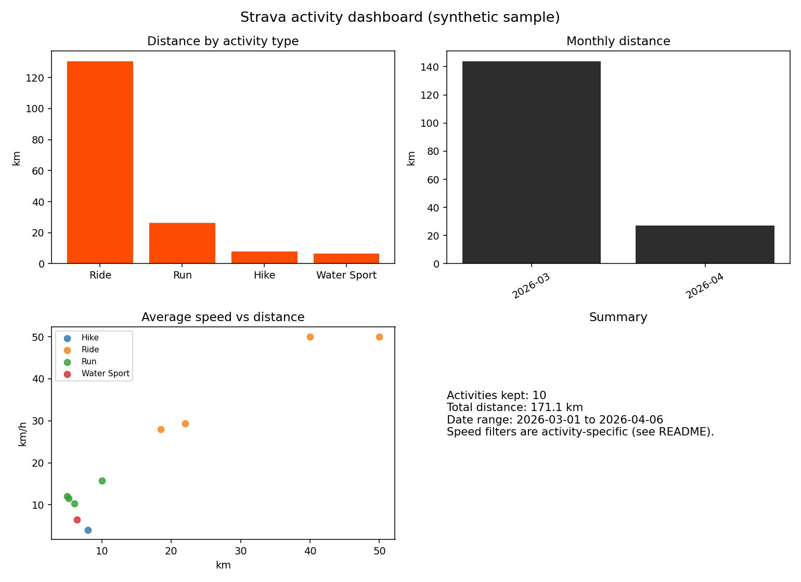

# Strava activity warehouse

Small ETL for a Strava `activities.csv` export: clean units, drop GPS outliers, and load a star schema in PostgreSQL. This repository ships **code plus a synthetic sample**. It does not include a personal Strava export (GPS tracks, photos, videos, or messaging data).



## What is in this repo

| Path | Role |
| --- | --- |
| `schema.sql` | PostgreSQL DDL for `dim_activity_type` and `fact_activities` |
| `pipeline.py` | Cleaning, activity-specific outlier rules, idempotent load |
| `main.py` | CLI: `python main.py --csv path/to/activities.csv` |
| `analysis.sql` | Example warehouse queries |
| `dashboard.py` | Writes `assets/dashboard.png` from cleaned data |
| `sample_data/activities.csv` | Synthetic export in Strava's column layout |
| `tests/` | Units, outlier rules, and repeat-load behavior |

Point `STRAVA_CSV` or `--csv` at your own `activities.csv` locally. Do not commit that file.

## Setup

```bash
python3 -m venv venv
source venv/bin/activate
pip install -r requirements.txt
createdb strava_analysis   # once
psql -d strava_analysis -f schema.sql
python main.py --csv sample_data/activities.csv
psql -d strava_analysis -f analysis.sql
python dashboard.py --csv sample_data/activities.csv --out assets/dashboard.png
pytest
```

`DATABASE_URL` overrides the default `postgresql://<you>@localhost:5432/strava_analysis`.

## Schema and loading

`schema.sql` is DDL only (no `psql` shell config, no incomplete `SELECT`). Python loads **directly into `fact_activities`**, resolving `activity_type_id` from `dim_activity_type`. There is no intermediate `activities` table and no `RENAME`.

Repeat runs are safe: activity types are inserted with `ON CONFLICT DO NOTHING` (or `INSERT OR IGNORE` on SQLite), and fact rows with the same `activity_id` are deleted then inserted so counts do not grow and edited fields from a re-export are applied.

## Units

Strava's bulk `activities.csv` mixes units and repeats some headers (`Distance` vs `Distance.1`). This pipeline assumes:

- `Distance` is **kilometers**
- `Elapsed Time` and `Moving Time` are **seconds**
- `Max Speed` and `Average Speed` are **meters per second** (converted with × 3.6)
- `Grade Adjusted Distance` is **meters** (converted with ÷ 1000)

## Outlier rules (assumptions)

A **global 45 km/h average-speed cutoff is too aggressive for cycling**. Recreational group rides can sit under that line, but time trials, fast road groups, long descents, and e-bikes often average 45 km/h or more. The same cutoff is far too loose for running: an 80 km/h average run is almost always a GPS spike.

Caps below are **sanity checks on average speed**, not athlete performance limits:

| Activity family | Max average speed kept |
| --- | --- |
| Run / trail / virtual run | 24 km/h (above a world-class marathon average) |
| Walk | 10 km/h |
| Hike | 15 km/h |
| Ride / virtual / e-bike / gravel | 80 km/h |
| Mountain bike ride | 70 km/h |
| Swim | 8 km/h |
| Water sport / paddle / row | 15–30 km/h |
| Workout / yoga / weights | no speed filter |

Unknown types default to **80 km/h**, not 45, so cycling-like labels are not dropped by accident.

Elapsed time must be under **72 hours**. A 24-hour cap would drop legitimate ultras; 72 hours still removes a watch that never stopped.

Negative distances and rows missing id, timestamp, or type are dropped.

## Privacy

A full Strava export can include GPX/FIT tracks, photos, videos, comments, and contacts. `.gitignore` excludes `export_*/`, media, GPS files, and non-sample CSVs. Publish this repo with synthetic `sample_data/` only.
